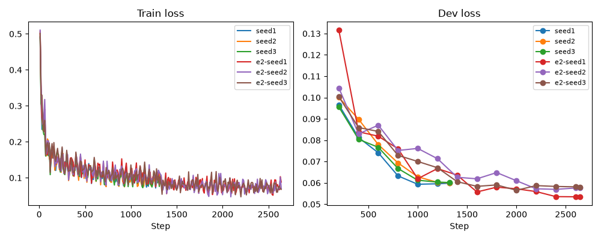

# cve2cwe

Should labelling a CVE with its CWE weakness type move from a frontier model to a small fine-tuned open-weight model? This repo answers with a locked test set, an acceptance bar committed before the result, and a gate script that prints the verdict.

## Decision

<!-- BEGIN headline -->
- **Verdict: PROMOTE.** On the locked test set the fine-tuned model scores 75.9% (mean of 3 seeds). The best baseline, a TF-IDF linear model, scores 72.7%. The best Claude run, Sonnet 5.5 with retrieved examples, scores 71.6%. The pass line was 74.7%.
- **Every seed clears every check.** Gains over the best baseline: +2.7, +3.6 and +3.3 points, with 95% intervals that stay above zero (lowest bound +1.3). Must-pass items: 859, 863 and 862 of 868. Invalid outputs: none.
- **What it labels on its own.** At the confidence threshold fixed on dev, it auto-labels 72.3% of test CVEs at 91.4% precision. The linear model auto-labels 61.7% at 90.1% precision.
- **A frontier fallback does not help.** On the CVEs the fine-tuned model is unsure about, it scores 33.8% and Claude Sonnet 5.5 scores 33.0%.
- **Cost per 1,000 CVEs:** $0.0133 on one rented H100 at full use, against $5.00 for Claude Sonnet 5.5 with retrieved examples. Prices read on 2026-11-24.
- **A usable output.** 6,180 CVEs published since 2026-04-15 have no CWE from NVD, the vendor or CISA. The model labelled all of them in 63.03 seconds for $0.0774 of GPU time. 3,405 clear the confidence threshold: [labels.csv](outputs/backlog/20261124T162831Z-be734af/labels.csv).
<!-- END headline -->

**Recommendation.** Use the fine-tuned model as the default labeller for CVEs that arrive without a CWE. Accept its label when the confidence clears the threshold, and send the rest to an analyst, not to a frontier model. Run it as a batch job on a rented GPU. An always-on GPU does not pay at CVE volumes. Keep the linear model as the fallback and as the champion any future model has to beat.

**Risks.**

- The gain over the best baseline is a few points, and that baseline is a linear model that costs almost nothing to run.
- All of the gain is on Linux kernel CVEs. On other CVEs every system here is weak, including this one.
- The labels are noisy. Where CISA also labelled a test CVE, it often disagrees with NVD. On the CVEs where the two agree, the best Claude run is still ahead of the fine-tuned model. The fine-tuned model wins overall because it predicts NVD's own labelling habits better.
- The confidence threshold was set for 95% precision on dev. On test it delivered less. The routing table shows both.
- The test set is the priority subset NVD still labels, not a random sample of new CVEs.

**Next steps.**

1. A learning curve: train on 10% and 30% of the data, to see how many labelled examples are needed before fine-tuning beats prompting.
2. Non-kernel CVEs: more recent non-kernel training data, and a check of whether crediting a parent or child CWE changes the picture.
3. Preference tuning (DPO) on the most frequent confusions, only if supervised fine-tuning stops improving.
4. What production still needs: monitoring, drift alarms, threshold recalibration and a retraining schedule.

Everything below is the evidence. Every number in this file is generated from files under results/ by "python -m cve2cwe report". CI fails if this file is out of date.

## The problem and what this solves

A CWE label on a CVE says what kind of weakness it is. Exposure management tools use it to group findings, suggest fixes and report.

NVD analysts used to add this label as routine. On 15 April 2026 NIST limited that work to a priority subset of CVEs ([NIST notice](https://www.nist.gov/news-events/news/2026/04/nist-updates-nvd-operations-address-record-cve-growth)). Many new CVEs now arrive without an analyst label.

<!-- BEGIN facts:coverage -->
| Publication year | Records | NVD analyst CWE |
|---|---|---|
| 2021 | 16,203 | 67.1% |
| 2022 | 24,207 | 68.7% |
| 2023 | 27,859 | 54.6% |
| 2024 | 39,608 | 33.9% |
| 2025 | 47,720 | 16.0% |
| 2026 | 101,116 | 4.1% |

In the test window, 7.4% of 83,820 CVEs have no CWE from any source. 93.8% of those are kernel CVEs.
<!-- END facts:coverage -->

The task: read the English description of a CVE and output the one CWE id an NVD analyst would assign, from a fixed list of 53.

## How it was solved

1. Build a dataset from the public NVD feeds and lock a test set by publication date.
2. Try every cheaper option first: keyword rules, a linear model, the base model with three prompt styles, and two Claude models.
3. Fine-tune Qwen3.5-4B with LoRA, three seeds, at two training lengths. Choose the length on dev.
4. Commit the acceptance bar. Only then run the fine-tuned models on test.
5. Let a script decide: PROMOTE or REJECT.

Tech stack: Python 3.12, uv, scikit-learn, PyTorch with Unsloth, PEFT and TRL, vLLM, llama.cpp, Gradio, the Anthropic API, Weights & Biases, one rented H100 on RunPod, GitHub Actions.

Built agent-first: I own the scope, decisions and merges; coding agents wrote the code and ran it under my review. The design was written before any code: [docs/DESIGN.md](docs/DESIGN.md).

## Where everything is

| What | Where |
|---|---|
| Training set | [data/processed/train.jsonl.gz](data/processed/train.jsonl.gz) |
| Dev set | [data/processed/dev.jsonl](data/processed/dev.jsonl) |
| Locked test set | [data/processed/test.jsonl](data/processed/test.jsonl), sha256 in [MANIFEST.json](data/processed/MANIFEST.json) |
| Dataset card | [data/DATASET_CARD.md](data/DATASET_CARD.md) |
| Source and licence notices | [data/NOTICE.md](data/NOTICE.md) |
| Evaluation code | [scorer.py](src/cve2cwe/scorer.py), [gate.py](src/cve2cwe/gate.py), [llm_eval.py](src/cve2cwe/llm_eval.py) |
| Raw model outputs | [outputs/](outputs/) |
| Results | [results/](results/) |
| Acceptance bar | [docs/ACCEPTANCE.md](docs/ACCEPTANCE.md), [configs/gate.yaml](configs/gate.yaml) |
| Backlog labels | [outputs/backlog/](outputs/backlog/) |

Source: the official NVD JSON 2.0 feeds for 2021 to 2026. CVE descriptions are used under the CVE Terms of Use. CWE names are from MITRE.

## The training data

<!-- BEGIN facts:data -->
| Split | Rows | From | To | Kernel share |
|---|---|---|---|---|
| train | 42,291 | 2021-01-04 | 2025-09-29 | 12.0% |
| dev | 2,759 | 2025-10-01 | 2026-04-14 | 25.4% |
| test | 2,266 | 2026-04-15 | 2026-11-18 | 71.7% |

Label set size: 53.

263,668 feed records, 6,955 rejected, 165,702 with no label, 23,137 placeholder, 814 with more than one CWE, 67,060 with a single NVD CWE, then 42,291 train, 2,759 dev and 2,266 test.

34.7% of test records have a CISA ADP label. Where CISA labelled the record, it agrees with NVD on 59.5%.

Near-duplicate share of test against train: 1.6% at or above 0.80, 0.4% at or above 0.90.
<!-- END facts:data -->

- Label: the single CWE assigned by NVD analysts. Records with a placeholder label or more than one CWE are dropped.
- Split by publication date. Train is before 2025-10-01, dev runs to 2026-04-14, and test starts on 2026-04-15, the day the NIST policy took effect. The base model was released before that date, so it cannot have seen test records. That cannot be said for the Claude models.
- Duplicates are removed across splits on normalised text. Nothing is ever dropped from test.
- Every system reads only the first 2,000 characters of the description.
- The test set is locked: its sha256 is in the manifest, the data stage refuses to overwrite it, and a test fails if it changes.

## Fine-tuning

- Base model: Qwen/Qwen3.5-4B, Apache 2.0, pinned to a commit hash.
- LoRA rank 16 on full-precision (bf16) weights, not 4-bit. Unsloth's guide for this model family advises against 4-bit training, and an adapter trained on bf16 weights merges into the same weights it was trained on.
- The training text is the exact serving prompt followed by the label. Loss is on the label and the end token only. A run fails before step 1 if any example would be truncated.
- Three seeds. The seed sets the adapter initialisation and the data order.
- Two lengths were trained, 1 epoch and 2 epochs. The length with the higher mean dev accuracy was chosen before any test run.

<!-- BEGIN table:training -->
| Run | Epochs | Training minutes | Last dev loss | Dev accuracy |
|---|---|---|---|---|
| 1 epoch, seed 1 | 1 | 9.5 | 0.05982 | 88.6% |
| 1 epoch, seed 2 | 1 | 10.1 | 0.06007 | 88.5% |
| 1 epoch, seed 3 | 1 | 10.1 | 0.06015 | 88.4% |
| 2 epochs, seed 1 | 2 | 18.6 | 0.05345 | 88.8% |
| 2 epochs, seed 2 | 2 | 18.6 | 0.05755 | 89.0% |
| 2 epochs, seed 3 | 2 | 18.6 | 0.05798 | 88.7% |

Mean dev accuracy, 1 epoch: 88.5%. 2 epochs: 88.8%. Chosen length: 2 epochs.
<!-- END table:training -->

Runs were tracked in Weights & Biases. That project stays private, because W&B stores the account email in each run's metadata and config. The loss values are exported to results/curves/ and plotted above.

## Inference

- The adapter is merged into the base weights and served with vLLM as a standalone checkpoint. Every LLM score in this repo, base or fine-tuned, went through the same client.
- A check confirmed that the prompt the server builds has the same token count as the training prompt.
- Confidence is the product of the probabilities of the label's tokens.

<!-- BEGIN table:serving -->
| Concurrency | Records per second | Latency p50 ms | Latency p95 ms | USD per 1,000 |
|---|---|---|---|---|
| 1 | 14.11 | 71.85 | 83.10 | $0.0870 |
| 8 | 56.14 | 135.4 | 166.5 | $0.0219 |
| 32 | 92.30 | 279.8 | 1244 | $0.0133 |
| 64 | 72.55 | 382.2 | 4170 | $0.0169 |

GPU: one H100 SXM 80 GB on RunPod Secure Cloud, on-demand, $4.42 per hour, read on the RunPod console on 2026-11-24.
<!-- END table:serving -->

A demo runs on a laptop with llama.cpp: [demo/README.md](demo/README.md). The adapter and the demo model file are at https://huggingface.co/ChaitanyaLaxman/cve2cwe-qwen3.5-4b.

<!-- BEGIN table:demo -->
| Records | Agreement with bf16 | Accuracy | Records with confidence |
|---|---|---|---|
| 200 | 98.5% | 88.0% | 200 |

Run 20261124T170118Z-79fe926. The demo model is the 4-bit file.
<!-- END table:demo -->

## The evaluation mechanism

- One strict parser for every system. The output must be exactly a CWE id from the list. Anything else counts as wrong.
- Accuracy is the main metric. Intervals are 95% bootstrap intervals from 10,000 resamples. Two systems are compared with a paired bootstrap on the same records.
- The champion is the best system other than the fine-tuned model, picked on the test set. That favours the champion.
- The code enforces the order: llm_eval.py refuses to score a fine-tuned model on test until the acceptance file is final and committed.
- Gate runs use one request at a time, because vLLM is not bit-reproducible when it batches. A batched run is shown next to them.

<!-- BEGIN table:gate -->
| Gate | Bar | Fine-tuned Qwen3.5-4B, seed 1 (shipped) | Fine-tuned Qwen3.5-4B, seed 2 | Fine-tuned Qwen3.5-4B, seed 3 |
|---|---|---|---|---|
| Test accuracy |  | 75.4% | 76.3% | 76.0% |
| G1 gain | mean >= 74.7% | mean 75.9% PASS | mean 75.9% PASS | mean 75.9% PASS |
| G2 noise | above 0 | +1.3 points PASS | +2.2 points PASS | +1.9 points PASS |
| G3 must-pass | >= 98.0% | 99.0% (859/868) PASS | 99.4% (863/868) PASS | 99.3% (862/868) PASS |
| G4 validity | <= 0.5% | 0.0% PASS | 0.0% PASS | 0.0% PASS |

Verdict: PROMOTE. Acceptance commit ca2c6d6f33b63cc72b79f430a5a82eec62c8d27e at 2026-11-24T14:53:59Z. First candidate test run started 2026-11-24T14:57:49Z.
<!-- END table:gate -->

## The result

<!-- BEGIN table:main -->
| System | Dev accuracy | Test accuracy | Test invalid rate | Test macro-F1 |
|---|---|---|---|---|
| Fine-tuned Qwen3.5-4B, mean of 3 seeds | 88.8% | 75.9% | 0.0% | 68.1% |
| Fine-tuned Qwen3.5-4B, seed 1 (shipped) | 88.8% | 75.4% (73.6% to 77.2%) | 0.0% | 67.7% |
| Fine-tuned Qwen3.5-4B, seed 2 | 89.0% | 76.3% (74.5% to 78.1%) | 0.0% | 68.6% |
| Fine-tuned Qwen3.5-4B, seed 3 | 88.7% | 76.0% (74.2% to 77.7%) | 0.0% | 68.1% |
| Fine-tuned, seed 1, batched serving | not run | 75.5% (73.7% to 77.3%) | 0.0% | 67.9% |
| TF-IDF + linear SVM | 86.7% | 72.7% (70.9% to 74.5%) | 0.0% | 61.5% |
| Claude Sonnet 5.5, retrieved examples | test only | 71.6% (69.8% to 73.5%) | 1.8% | 65.9% |
| Claude Sonnet 5.5, zero-shot | test only | 71.6% (69.7% to 73.4%) | 2.0% | 64.9% |
| Claude Haiku 5.5, retrieved examples | test only | 68.5% (66.6% to 70.4%) | 6.9% | 63.4% |
| Claude Haiku 5.5, zero-shot | test only | 65.8% (63.9% to 67.8%) | 8.3% | 62.5% |
| Base Qwen3.5-4B, retrieved examples | 78.0% | 65.7% (63.8% to 67.6%) | 0.4% | 56.4% |
| Base Qwen3.5-4B, few-shot | 70.5% | 60.2% (58.2% to 62.1%) | 0.8% | 46.9% |
| Base Qwen3.5-4B, zero-shot | 67.3% | 56.6% (54.5% to 58.6%) | 0.3% | 39.5% |
| Keyword rules | 51.7% | 39.5% (37.6% to 41.6%) | 56.4% | 31.3% |
| Majority class | 13.4% | 10.2% (8.9% to 11.4%) | 0.0% | 1.0% |

Claude runs are test only. The mean of the seeds has no stored interval.
<!-- END table:main -->

Where the gain comes from:

<!-- BEGIN table:slices -->
| Slice | n | Fine-tuned Qwen3.5-4B, seed 1 (shipped) | TF-IDF + linear SVM | Claude Sonnet 5.5, retrieved examples |
|---|---|---|---|---|
| kernel | 1,624 | 83.1% | 79.1% | 77.0% |
| non-kernel | 642 | 56.1% | 56.4% | 58.1% |
| CISA agrees | 468 | 79.9% | 78.0% | 82.9% |
| CISA disagrees | 318 | 43.4% match NVD, 13.2% match CISA | 38.7% match NVD, 14.8% match CISA | 35.8% match NVD, 22.6% match CISA |
| CISA absent | 1,480 | 80.9% | 78.3% | 75.7% |
<!-- END table:slices -->

How much can be labelled without a person or a frontier model:

<!-- BEGIN table:routing -->
| System | Threshold | Dev coverage | Dev precision | Test auto-label rate | Test precision | Accuracy on the rest | Best Claude on the rest | Cascade accuracy |
|---|---|---|---|---|---|---|---|---|
| Fine-tuned Qwen3.5-4B, seed 1 (shipped) | dev 95% threshold | 85.0% | 95.0% | 72.3% | 91.4% | 33.8% | 33.0% | 75.2% |
| Fine-tuned Qwen3.5-4B, seed 1 (shipped) | dev 97% threshold | 78.1% | 97.0% | 65.6% | 93.8% | 40.3% | 36.6% | 74.1% |
| TF-IDF + linear SVM | dev 95% threshold | 78.7% | 95.0% | 61.7% | 90.1% | 44.6% | 46.9% | 73.6% |
| TF-IDF + linear SVM | dev 97% threshold | 65.0% | 97.0% | 42.9% | 95.0% | 56.0% | 55.6% | 72.5% |
<!-- END table:routing -->

What it costs:

<!-- BEGIN table:cost -->
| System | USD per 1,000 |
|---|---|
| Fine-tuned Qwen3.5-4B, seed 1 (shipped), concurrency 32 | $0.0133 |
| Claude Haiku 5.5, retrieved examples | $0.250 |
| Claude Haiku 5.5, zero-shot | $0.160 |
| Claude Sonnet 5.5, retrieved examples | $5.00 |
| Claude Sonnet 5.5, zero-shot | $3.19 |
| Fine-tuned Qwen3.5-4B, seed 1 (shipped) cascade, dev 95% threshold | $1.40 |
| Fine-tuned Qwen3.5-4B, seed 1 (shipped) cascade, dev 97% threshold | $1.73 |
| TF-IDF + linear SVM | CPU, not measured |

| Claude run | Break-even records per month |
|---|---|
| Claude Haiku 5.5, retrieved examples | 12,896,702 |
| Claude Haiku 5.5, zero-shot | 20,206,433 |
| Claude Sonnet 5.5, retrieved examples | 645,312 |
| Claude Sonnet 5.5, zero-shot | 1,010,483 |

Break-even is the monthly volume at which a GPU left on for 730 hours at $4.42 per hour costs the same as that Claude run. Backlog batch GPU cost: $0.0774. The test window averages 11,536 CVEs per month (83,820 records, 221 days from 2026-04-15 to 2026-11-22, the latest publication in the locked test set and the unlabelled backlog, a month of 730 hours). That is below every break-even volume.
<!-- END table:cost -->

Labels for CVEs that have none today:

<!-- BEGIN table:backlog -->
6,180 rows. At the dev 95% threshold: 3,405 (55.1%). At the dev 97% threshold: 2,826 (45.7%). Kernel share: 5,795 (93.8%).

| CWE | Name | Rows |
|---|---|---|
| CWE-416 | Use After Free | 1,148 |
| CWE-476 | NULL Pointer Dereference | 801 |
| CWE-401 | Missing Release of Memory after Effective Lifetime | 726 |
| CWE-125 | Out-of-bounds Read | 699 |
| CWE-787 | Out-of-bounds Write | 451 |
| CWE-667 | Improper Locking | 417 |
| CWE-908 | Use of Uninitialized Resource | 274 |
| CWE-362 | Concurrent Execution using Shared Resource with Improper Synchronization | 242 |
| CWE-770 | Allocation of Resources Without Limits or Throttling | 185 |
| CWE-617 | Reachable Assertion | 150 |
<!-- END table:backlog -->

These are predictions, not ground truth. The threshold was set on labelled data, and the unlabelled CVEs are a different population.

Where it is wrong:

<!-- BEGIN table:errors -->
| Gold | Predicted | Count |
|---|---|---|
| CWE-787 | CWE-125 | 36 |
| CWE-269 | CWE-287 | 23 |
| CWE-306 | CWE-287 | 18 |
| CWE-787 | CWE-120 | 17 |
| CWE-362 | CWE-416 | 13 |
| CWE-863 | CWE-287 | 12 |
| CWE-862 | CWE-863 | 11 |
| CWE-401 | CWE-416 | 10 |
| CWE-476 | CWE-908 | 10 |
| CWE-125 | CWE-129 | 9 |

| CVE | Gold | Predicted | Confidence | CISA label |
|---|---|---|---|---|
| [CVE-2026-45501](https://nvd.nist.gov/vuln/detail/CVE-2026-45501) | CWE-79 | CWE-918 | 99.9% | none |
| [CVE-2026-43456](https://nvd.nist.gov/vuln/detail/CVE-2026-43456) | CWE-908 | CWE-843 | 99.6% | CWE-843 |
| [CVE-2026-45641](https://nvd.nist.gov/vuln/detail/CVE-2026-45641) | CWE-125 | CWE-843 | 99.4% | none |
| [CVE-2026-45943](https://nvd.nist.gov/vuln/detail/CVE-2026-45943) | CWE-125 | CWE-476 | 99.3% | none |
| [CVE-2026-45635](https://nvd.nist.gov/vuln/detail/CVE-2026-45635) | CWE-416 | CWE-843 | 99.2% | none |
| [CVE-2026-45461](https://nvd.nist.gov/vuln/detail/CVE-2026-45461) | CWE-787 | CWE-416 | 99.2% | none |
<!-- END table:errors -->

## Run it yourself

    make setup        # Python 3.12 environment with pinned versions
    make data         # rebuild the dataset from the NVD feeds and check the lock
    make baselines    # majority, keyword rules, TF-IDF + SVM
    make test         # unit tests and the README check, also run in CI

The GPU stages (train, merge, llm-eval, bench, backlog) run on a rented pod. Their commands and pinned environments are in [docs/DESIGN.md](docs/DESIGN.md) and requirements/. Every run writes a run.json with its seed, config, git commit and package versions.

## Honest limits

- One day of work on one task. It is a proof of concept with evidence, not a production system.
- One fine-tuning recipe. Only the number of epochs was varied.
- Claude models were run on the test set only, with prompts that were not tuned.
- Batched serving changes a small share of answers. The gate numbers come from unbatched runs.
- The GPU sat idle for much of the day while code was written. The spend table shows it.
- Two early training runs record a dirty git tree because of a faulty check. The change log in the design explains how that was verified.

## What was spent

<!-- BEGIN table:spend -->
As of 2026-11-24T16:31:36Z. The pod was still running.

GPU H100 SXM 80 GB: 8.360 hours, $37.0. Share of billed hours with no recorded run: 68.2%.

| Purpose | Seconds | Runs |
|---|---|---|
| training | 5,653.58 | 6 |
| merge | 305.00 | 8 |
| evaluation | 3,294.34 | 22 |
| benchmark | 65.00 | 1 |
| backlog | 63.03 | 1 |
| gguf_export | 197.00 | 1 |

| Claude run | USD |
|---|---|
| Claude Haiku 5.5, retrieved examples | $0.567 |
| Claude Haiku 5.5, zero-shot | $0.362 |
| Claude Sonnet 5.5, retrieved examples | $11.3 |
| Claude Sonnet 5.5, zero-shot | $7.24 |

Claude total $19.5. GPU plus Claude: $56.4.

Provider dashboards, read by the reviewer on 2026-11-24.

RunPod, read 2026-11-24T17:21Z: spent $40.17 (loaded $80.00 minus balance $39.83), next to $40.13 for uptime 9h 5m at $4.418 per hour.

Anthropic console for 2026-11-24, data as of 2026-11-24T16:44Z: Claude Sonnet 5.5 $20.48 next to $18.6 from the run files; Claude Haiku 5.5 $0.94 next to $0.929 from the run files.

The difference is calls that wrote no run file, such as the 30-record sanity checks.

This table covers experiment compute. It excludes the coding agents.
<!-- END table:spend -->

## Licence and credits

Code: MIT. Data: NVD (a US government work), CVE descriptions under the CVE Terms of Use, CWE names under MITRE's terms. See [data/NOTICE.md](data/NOTICE.md). Base model: Qwen/Qwen3.5-4B, Apache 2.0.
